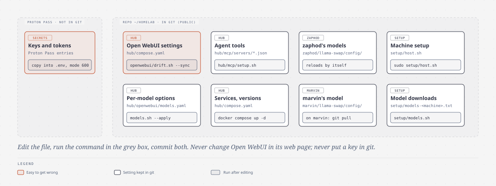
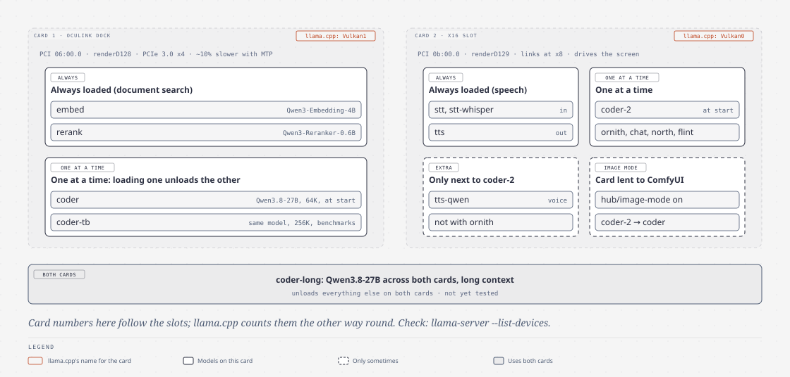
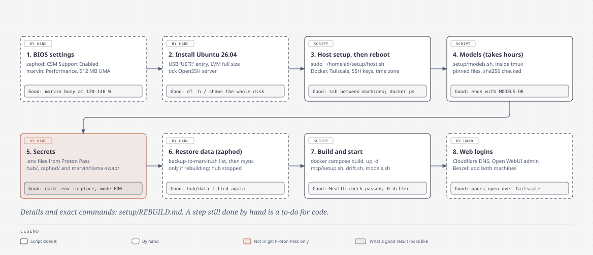

# Diagrams

Pictures of how the lab fits together. Each one shows on GitHub as an image; the text under it says the same thing
in words. Last updated 2026-10-30.

1. [The lab: what runs where](#1-the-lab-what-runs-where)
2. [Where each setting lives](#2-where-each-setting-lives)
3. [zaphod's two graphics cards](#3-zaphods-two-graphics-cards)
4. [Rebuilding a machine, in order](#4-rebuilding-a-machine-in-order)
5. [Results: tool use and speed](#5-results-tool-use-and-speed)

## 1. The lab: what runs where

- Your laptop or phone reaches **Caddy** on zaphod (HTTPS) over Tailscale. Nothing listens on the open internet.
- Caddy serves the **web services**: Open WebUI, the MCPJungle tool gateway, Homepage, Beszel, MLflow.
- They ask **zaphod's llama-swap** for models. When the model is `marvin/big`, zaphod passes the request on to
  **marvin's llama-swap** (a "peer"), so marvin shows up as one more model.

Details: [FEATURES.md](../../FEATURES.md) sections 1-3.

## 2. Where each setting lives

Edit the file, run the command, commit both in the same commit.

| To change | Edit | Then run |
| --- | --- | --- |
| Open WebUI settings | `hub/compose.yaml` (open-webui environment) | `hub/openwebui/drift.sh --sync`. Never change them in the web page |
| Per-model options in Open WebUI | `hub/openwebui/models.yaml` | `hub/openwebui/models.sh --apply` |
| Agent tools | `hub/mcp/servers/*.json` | `hub/mcp/setup.sh` |
| Web services and their versions | `hub/compose.yaml` | `cd ~/homelab/hub && docker compose up -d` |
| zaphod's models | `zaphod/llama-swap/config/config.yaml` | Nothing: llama-swap reloads by itself. Check: `cd ~/llama-swap && docker compose logs --tail 20` |
| marvin's model | `marvin/llama-swap/config/config.yaml` | Push, then on marvin `cd ~/homelab && git pull`; it reloads by itself |
| Machine setup (packages, boot, time zone) | `setup/host.sh` | `sudo ~/homelab/setup/host.sh` on that machine |
| Which model files to download | `setup/models-<machine>.txt` | `~/homelab/setup/models.sh` |
| Keys and tokens | Proton Pass | Copy into the right `.env` file (mode 600). Never into git |

## 3. zaphod's two graphics cards

- **Card 1** (OCuLink dock, PCIe 3.0 x4, about 10% slower with MTP): `embed` and `rerank` always loaded;
  `coder` or `coder-tb`, one at a time.
- **Card 2** (x16 slot, drives the screen): speech models always loaded; one of `coder-2`, `ornith`, `chat`, `north`,
  `flint` at a time. `tts-qwen` fits only next to `coder-2`. In image mode, ComfyUI borrows the card and `coder-2`
  requests go to `coder`.
- **`coder-long`** uses both cards and unloads everything else (not yet tested).
- **Watch out:** llama.cpp numbers the cards the other way round: card 1 = `Vulkan1`, card 2 = `Vulkan0`.
  Check with `llama-server --list-devices`.

Source: `zaphod/llama-swap/config/config.yaml` (the `routing` matrix and the `image-mode` profile).

## 4. Rebuilding a machine, in order

1. BIOS settings (by hand). Good: marvin's GPU at 130-140 W when busy.
2. Install Ubuntu 26.04 (by hand). Good: `df -h /` shows the whole disk.
3. `sudo ~/homelab/setup/host.sh`, then reboot. Good: `ssh` between the machines works; `docker ps` works without sudo.
4. `setup/models.sh` in tmux (hours). Good: ends with `MODELS-OK`.
5. `.env` files from Proton Pass (by hand). Good: each one in place, mode 600.
6. Restore data from marvin (zaphod only, if rebuilding). Good: `hub/data` filled again.
7. Build and start the services. Good: "Health check passed"; drift check says 0 differ.
8. Web logins: Cloudflare DNS, Open WebUI admin, Beszel (by hand). Good: the pages open over Tailscale.

Exact commands: [setup/REBUILD.md](../../setup/REBUILD.md).

## 5. Results: tool use and speed

The top four are within run-to-run noise (about ±4 points); Flint is behind. Source:
[tuning/results.md](../../tuning/results.md).

Same model file on marvin: Strata reads a long prompt 2.6× as fast as llama.cpp and writes 26% faster. On Terminal-Bench at the same thinking level, Strata scored 17/19 (4.39 h), llama.cpp 19/19.
Source: [plans/strix-strata.md](../../plans/strix-strata.md) Phase 1, MLflow f807b742.

## Changing a diagram

The source of each picture is the HTML file in [`src/`](src/) (open it in a browser to see it with its proper
fonts). After editing one, export it again with the diagram-design skill:
`python3 ~/.claude/skills/diagram-design/scripts/export_svg.py --system-fonts src/<name>.html <name>.svg`.
Keep the text on this page in step with the picture.
